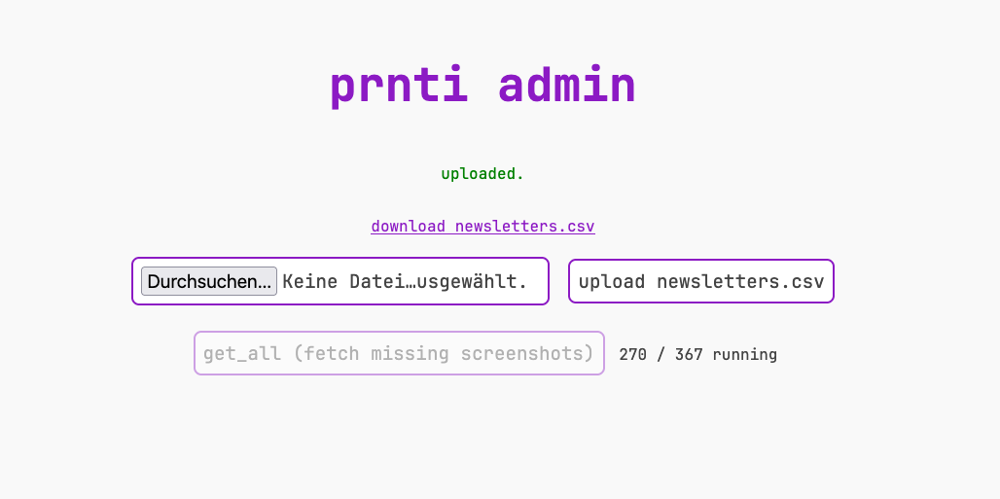

# Updating newsletters.csv on prnti





## 1. Open the admin page

Make sure your computer is in the same network as prnti, then open:

http://prnti.local:8080

### Prnti.local does not work?

Find the IP address of prnti, e.g. with [Angry IP Scanner](https://angryip.org):

1. Install and start Angry IP Scanner.

2. Press **Start** to scan your network.

3. Look for a device named `prnti` ( or a Device with "Raspberry Pi" as vendor).

4. Open `http://<that ip>:8080` in your browser, e.g. `http://192.168.1.42:8080`.

   > [!TIP]
   >
   > You can also use your router (Fritzbox, SwisscomBox etc.) to find the ip

## 2. Download

Click **download newsletters.csv**. The file is saved to your downloads folder.

## 3. Edit

Open the file in a text editor or spreadsheet program and add new rows at the end.
One row per newsletter, columns separated by commas:

```
id,type,nr,date,url
368,wintibrief,349,2026-09-18,https://mailchi.mp/wnti/some-newsletter-slug
```

- `id`: next free number, three digits (e.g. `368`)
- `type`: `wintibrief` or `parlamentsbrief`
- `nr`: the newsletter number shown in the header of the newsletter (`#349`)
- `date`: send date as `YYYY-MM-DD`
- `url`: the "online lesen" link of the newsletter, without anything after `?`

> [!IMPORTANT]
>
> Do not change or delete existing rows. Save as plain CSV (not `.xlsx`).

> [!CAUTION]
>
> Don't forget a comma or it won't work

> [!TIP]
>
> You can use an LLM to fetch the missing newsletters and update the csv.
>
> ```
> Fetch all missing newsletter up until today from wnti.ch and update this newsletters.csv file
> Don't forget parlamentsbriefe. Fix any errors in numbering and add missing information.
> Make sure the csv is valid.
> Be Thorough
> ```
>
> 

## 4. Upload

On the admin page choose the edited file and click **upload newsletters.csv**.
If asked for a password, leave the username empty and enter the admin password.

## 5. Fetch screenshots

Click **get_all (fetch missing screenshots)**. Progress is shown next to the button.

It wil download and render all the Newsletters.

Wait until it says done, then the new newsletters can be printed.
